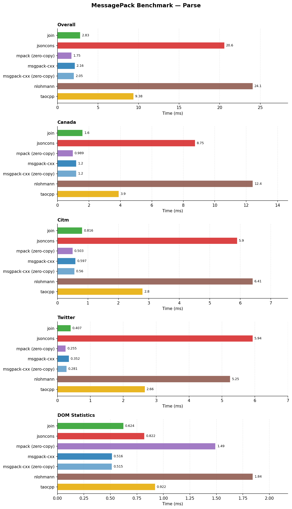
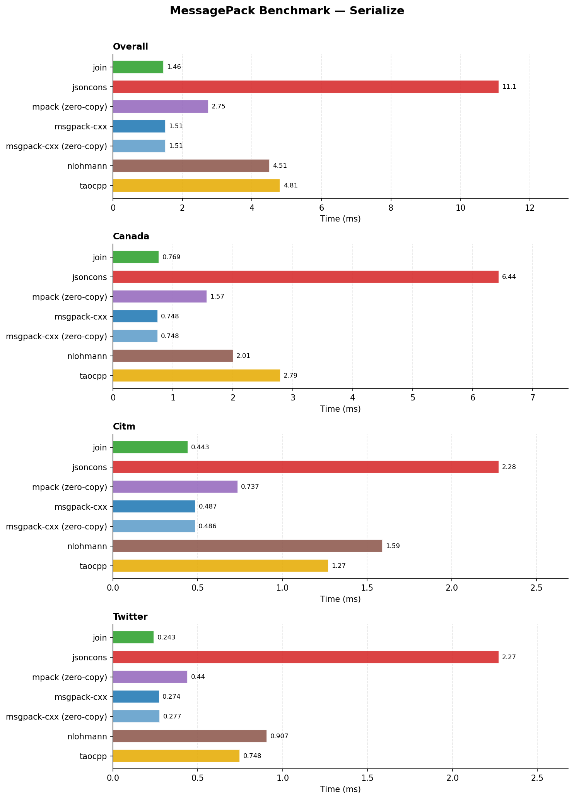
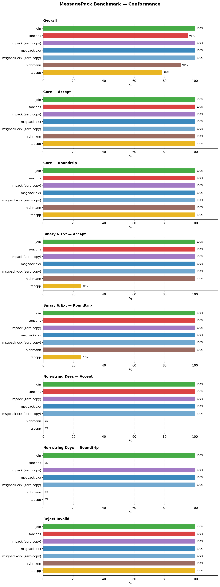

# pack-benchmark

Comparative benchmarks of MessagePack libraries in C++, measuring parse, serialize, and DOM statistics performance across three real-world datasets (Canada, CitmCatalog, Twitter). Includes a conformance suite covering format acceptance, rejection of malformed input, and value-preserving roundtrip.

Companion of [json-benchmark](https://github.com/joinframework/json-benchmark), with the same protocol and layout.

## Table of contents

- [Libraries](#libraries)
- [Datasets](#datasets)
- [Build](#build)
- [Running benchmarks](#running-benchmarks)
- [Plots](#plots)
- [What the benchmarks measure](#what-the-benchmarks-measure)
  - [Parse](#parse)
  - [Serialize](#serialize)
  - [Statistics](#statistics)
  - [Conformance](#conformance)
- [Notes](#notes)
- [Test machine](#test-machine)
- [Results](#results)
  - [Performance](#performance)
  - [Conformance](#conformance-1)
  - [Conclusion](#conclusion)
- [License](#license)

## Libraries

| Library | Parse | Serialize | Statistics | Conformance |
|---------|-------|-----------|------------|-------------|
| [Join](https://github.com/joinframework/join) | ✓ | ✓ | ✓ | ✓ |
| [jsoncons](https://github.com/danielaparker/jsoncons) | ✓ | ✓ | ✓ | ✓ |
| [MPack](https://github.com/ludocode/mpack) (zero-copy) | ✓ | ✓ | ✓ | ✓ |
| [msgpack-cxx](https://github.com/msgpack/msgpack-c/tree/cpp_master) (default) | ✓ | ✓ | ✓ | ✓ |
| [msgpack-cxx](https://github.com/msgpack/msgpack-c/tree/cpp_master) (zero-copy) | ✓ | ✓ | ✓ | ✓ |
| [nlohmann/json](https://github.com/nlohmann/json) | ✓ | ✓ | ✓ | ✓ |
| [taocpp/json](https://github.com/taocpp/json) | ✓ | ✓ | ✓ | ✓ |

All dependencies are fetched automatically via CMake FetchContent, at pinned versions (`cmake/deps.cmake`).

Libraries fall into two categories, the zero-copy ones being labelled `(zero-copy)` in the plots:
- **copying** — the DOM owns its strings, binaries and extension payloads, and the input buffer can be released after parse;
- **zero-copy** — the DOM references the input buffer for strings, binaries and extension payloads, which must outlive the DOM. Parse then does no string copy, and statistics or serialize read the payloads from the input. Their figures are not like-for-like with the copying libraries.

**msgpack-cxx** is used header-only, without Boost (`MSGPACK_NO_BOOST`). Its DOM is a `msgpack::object` tree allocated in a `msgpack::zone`. It is benchmarked in two configurations:
- **default** — no `unpack_reference_func`: strings, binaries and extensions are copied into the zone;
- **zero-copy** — an `unpack_reference_func` returning true for `STR`, `BIN` and `EXT`, so their payloads reference the input buffer.

**MPack** is a C library, built from its sources with `MPACK_EXTENSIONS=1`: without it, extension types are rejected as unsupported. Its node tree (`mpack_tree_t`) is read-only and always references the input buffer, so it is zero-copy only. It is serialized by walking the tree with the `mpack_writer_t` API into a growable buffer.

**nlohmann/json**, **jsoncons** and **taocpp/json** are JSON libraries with a MessagePack codec on top of their JSON DOM (`from_msgpack`/`to_msgpack`, `decode_msgpack`/`encode_msgpack`, `msgpack::from_string`/`msgpack::to_string`). Their object keys are strings: nlohmann/json and taocpp/json reject maps with other keys, jsoncons converts such keys to their text form. taocpp/json rejects extension types. jsoncons (`jsoncons::json`), nlohmann/json and taocpp/json store objects sorted by key, so their output does not keep the input key order.

**Join** stores `bin` and extension types as binary values, an extension keeping its type as the binary subtype (timestamps are extensions of type -1, not converted); map keys may be nil, booleans, numbers, strings, `bin` or extensions.

Every adapter decodes a whole document: input left over after the first object is rejected. Join, nlohmann/json (`from_msgpack` with `strict = true`) and taocpp/json (whose grammar ends with `eof`) check it natively. msgpack-cxx, MPack and jsoncons decode one object from a stream and report the bytes they used (`unpack` offset, `mpack_tree_size`, `msgpack_bytes_reader::column`); their adapters reject the input when that count is not its size. jsoncons is therefore decoded with `msgpack_bytes_reader` and a `json_decoder`, since `decode_msgpack` ignores trailing bytes.

Output buffers follow one rule: each library writes into its native output buffer (`std::string` for jsoncons, nlohmann/json and taocpp/json, `msgpack::sbuffer` for msgpack-cxx, MPack's growable writer). When the adapter has to provide the buffer, as for Join's `std::ostream`, it starts at 8 KiB and doubles when full.

## Datasets

| File | Size | Characteristics |
|------|------|-----------------|
| `canada.msgpack` | ~1.1 MB | Geometry data — float-heavy (coordinate pairs), large arrays |
| `citm_catalog.msgpack` | ~0.3 MB | Event catalog — deeply nested objects, mixed types |
| `twitter.msgpack` | ~0.4 MB | Social feed — Unicode strings, many small objects |

The files are the json-benchmark datasets converted with the reference Python implementation ([msgpack](https://pypi.org/project/msgpack/)), using the minimal encoding: smallest integer format, every JSON floating-point number as `float64`, strings as `str`. To regenerate them:

```bash
python3 -m venv .venv
.venv/bin/pip install msgpack
.venv/bin/python -I scripts/gen_data.py ../json-benchmark/data data
```

Each benchmark binary is run several times, each repetition in a new process. The time reported is the minimum across repetitions, and the overall time is the sum over the three datasets (ms), computed per repetition before taking the minimum.

## Build

Configure:

```bash
cmake -B build -DCMAKE_BUILD_TYPE=Release
```

Join is fetched from its `main` branch; to build against a local working tree instead:

```bash
cmake -B build -DCMAKE_BUILD_TYPE=Release -DFETCHCONTENT_SOURCE_DIR_JOIN=/path/to/join
```

Compile:

```bash
cmake --build build -j$(nproc)
```

## Running benchmarks

Run everything and generate plots:

```bash
bash scripts/run_bench.sh
```

Single binary (one per operation and library, `bench_<operation>_<library>`):

```bash
GLIBC_TUNABLES=glibc.malloc.mmap_threshold=33554432:glibc.malloc.trim_threshold=4294967296 \
taskset -c 2 ./build/benchmarks/performance/bench_parse_mpack \
    --benchmark_format=json \
    --benchmark_out=results/parse_mpack.json \
    --benchmark_min_warmup_time=0.5
```

Conformance only:

```bash
./build/benchmarks/conformance/conformance --output results/conformance.json
```

> [!NOTE]
> Default: 3 repetitions per binary (`REPETITIONS`), each in a new process, minimum reported. Override with e.g. `REPETITIONS=5 bash scripts/run_bench.sh`. Raw per-repetition results are written to `results/runs/`.

## Plots

Install plotting dependencies, either from the distribution (Debian/Ubuntu):

```bash
sudo apt install python3-matplotlib python3-pandas
```

or in a virtual environment:

```bash
python3 -m venv .venv
.venv/bin/pip install -r plots/requirements.txt
```

Generate the charts:

```bash
python3 plots/plot.py results/conformance.json results/runs/*.json
```

Bars show the minimum across processes.

PNGs are written to `plots/`:
- `performance_parse.png` — parse (overall + per dataset) and DOM statistics
- `performance_serialize.png` — serialize (overall + per dataset)
- `conformance.png` — overall score followed by one subplot per score (accept and roundtrip for core, binary & ext and non-string keys, then reject)

## What the benchmarks measure

### Parse

**Goal**: time to decode a MessagePack document into an in-memory DOM.

The benchmark calls `Adapter::parse(msgpack)` and measures only the decoding time. DOM destruction is excluded from timing (`PauseTiming` / `ResumeTiming`), as in json-benchmark.

**What is measured**: format decoding, byte-order conversion, and DOM construction.

**What is not measured**: DOM traversal, serialization, input I/O.

---

### Serialize

**Goal**: time to serialize a pre-decoded DOM back to MessagePack bytes.

The document is decoded once before the timing loop; each iteration serializes the same DOM into the library's native output buffer.

**What is measured**: DOM traversal and MessagePack generation.

Each library picks its own encoding. Join, jsoncons and nlohmann/json write a `float64` as `float32` when the conversion is exact, so their output on `canada.msgpack` is 648 bytes shorter (1 056 145 instead of 1 056 793); the others keep `float64`. MPack and msgpack-cxx reproduce the three inputs byte for byte; Join does on `citm_catalog.msgpack` and `twitter.msgpack`; beyond the `float32` narrowing, jsoncons, nlohmann/json and taocpp/json differ from the input only by their sorted key order.

---

### Statistics

**Goal**: time to traverse the entire DOM and accumulate counts of each node type (maps, arrays, strings, numbers, booleans, nils).

The document is decoded once before the timing loop. Each iteration walks every node in the tree. A map key is counted as a value of its own type (a string key as a string, an integer key as a number), so the counts stay comparable with json-benchmark's, where every key is a string.

---

### Conformance

Run once (no timing), on hand-written MessagePack byte strings. The 80 valid documents are split into three categories, each scored twice — **accept** (the library decodes it) and **roundtrip** (decode, serialize, and compare the output value by value with the input):

1. **Core** (55 cases): nil and booleans, positive and negative fixint, `uint8/16/32/64` and `int8/16/32/64` at their bounds, non-minimal integer, string and array encodings, `float32` and `float64` (including `-0.0`, subnormals, infinities and NaN), `fixstr/str8/str16/str32` (including an embedded NUL and UTF-8), empty and nested arrays and maps, `array16/32` and `map16/32` with string keys, and 100 nested arrays.
2. **Binary & Ext** (16 cases): `bin8/16/32`, `fixext1..16`, `ext8/16/32`, and the three timestamp formats.
3. **Non-string Keys** (9 cases): maps keyed by a positive, negative or `uint64` integer, nil, booleans, a float, a `bin`, an array, or a map.

**Reject** (35 cases): empty input, the never-used byte `0xc1`, every fixed-size format truncated, string, binary and extension payloads shorter than their header, arrays and maps missing elements, `str32`, `bin32`, `array32` and `map32` headers declaring 4 GiB with no data, and a trailing byte after a complete document.

The roundtrip is judged by a small MessagePack decoder in `conformance/main.cpp`, independent of every library under test. It decodes both documents into a plain value tree and compares them: integers by value whatever their encoding width or signedness, floating-point numbers bitwise as `double` after widening `float32` (`float32` 0.1 and the `float64` holding the same value are equal), strings and binaries byte for byte and never with each other, extensions by type and payload, maps key by key regardless of order.

In addition, an **output check** guards the performance benchmarks: on each dataset, the DOM statistics of every library must match, re-decoding a library's own serialize output must yield the same statistics, and the output must equal the input value by value (same comparison as the roundtrip). Any mismatch is reported on stderr and makes `conformance` exit with status 1, which stops `run_bench.sh` before any timing.

## Notes

- `-march=native`: CPU-specific SIMD optimisations. Results are not portable across machines.
- Every binary is compiled as C++20 (`CMAKE_CXX_STANDARD 20`), the standard Join requires.
- Each library is measured in its own binary (`bench_<operation>_<library>`), linked only against that library, and each repetition runs in a new process, interleaved across libraries (see json-benchmark for the measurements behind both choices).
- The allocator policy is fixed for every library (`GLIBC_TUNABLES`: 32 MB `mmap` threshold, trimming disabled), and `--benchmark_min_warmup_time=0.5` lets the heap reach its steady-state size before measurement. Each benchmark reports its page faults per iteration as the `minflt` counter; `plot.py` warns when it is not zero.
- Benchmarks are pinned with `taskset -c $BENCH_CPU` (default 2). They are single-threaded, so pinning the process pins the measured thread.
- Build and measurement are separated. `run_bench.sh` refuses to measure unless the governor is `performance` and boost is disabled, then waits until the current frequency of `$BENCH_CPU` (`scaling_cur_freq`) is back to 98% of its maximum (`scaling_max_freq`). It reads `cpufreq` in sysfs rather than `/proc/cpuinfo`, which has no `cpu MHz` line on ARM. `ALLOW_NOISY=1` overrides both checks.
- Every compiled library is linked statically, and every library runs with its default allocator.
- Serialize returns each library's output buffer (see the buffer rule under [Libraries](#libraries)) without converting it.
- Result JSONs are gitignored (`results/`); plots are committed under `plots/`.

## Test machine

All figures below come from a single run on this machine (3 repetitions, each in its own process). They are not portable: `-march=native` alone makes them specific to this CPU.

| | |
|---|---|
| CPU | AMD Ryzen 7 2700X, 8 cores / 16 threads (Zen+), 1 socket, 1 NUMA node |
| Frequency | 3700 MHz, `performance` governor, boost disabled |
| Caches | L1d 8 × 32 KiB, L2 8 × 512 KiB, L3 2 × 8 MiB |
| RAM | 16 GiB |
| OS | Ubuntu 26.04.1 LTS, kernel 7.0.0-42-generic |
| Toolchain | GCC 15.2.0, CMake 4.2.3 |
| Compile flags | `-O3 -DNDEBUG -march=native -std=c++20`; `MSGPACK_NO_BOOST` for msgpack-cxx, `MPACK_EXTENSIONS=1` for MPack |
| Join | `main` at `e4bd643` (2026-11-11) |
| Pinning | `taskset -c 2` (physical core, SMT sibling 10) |
| Conditions | idle machine, 3 repetitions, run started once the CPU was back to its rated clock (3688 MHz); no page fault in steady state; spread across repetitions below 2% for 42 of 63 benchmarks and below 5% for 56; outliers are jsoncons serialize (25% on `twitter.msgpack`, 11% on `citm_catalog.msgpack`), taocpp/json statistics on `citm_catalog.msgpack` (7%) and msgpack-cxx statistics on `canada.msgpack` (5–7%) |

## Results

Measured on the machine above. Re-run `scripts/run_bench.sh` to reproduce on other hardware; results are not portable across machines (`-march=native`).

### Performance





**Parse**: **MPack** leads at 1.75 ms, followed by **msgpack-cxx** zero-copy (2.05 ms) and default (2.16 ms); both msgpack-cxx variants take the same 1.21 ms on `canada.msgpack`, which holds almost no strings, and differ on `twitter.msgpack` (0.28 against 0.35 ms), where the default variant copies every string into its zone. **Join** (2.83 ms), the fastest copying DOM after msgpack-cxx default, is 1.3× behind it and 1.6× behind MPack. The JSON libraries with a MessagePack codec are much slower: **taocpp/json** (9.38 ms), then **jsoncons** (20.6 ms) and **nlohmann/json** (24.1 ms), 12–14× MPack.

**Serialize**: **Join** leads at 1.46 ms, with both **msgpack-cxx** variants (1.51 ms) right behind. **MPack** (2.75 ms) is slower: its tree is read-only, so it is written back node by node through the `mpack_writer_t` API. **nlohmann/json** (4.51 ms) and **taocpp/json** (4.81 ms) follow, and **jsoncons** (11.1 ms) is the slowest, with the largest spread across processes (up to 25%).

**Statistics**: both **msgpack-cxx** variants lead at 0.52 ms, followed by **Join** (0.62 ms; 0.38 against 0.28 ms on `canada.msgpack`, on par elsewhere). **jsoncons** (0.82 ms), the fastest of all on `twitter.msgpack` (0.086 ms), and **taocpp/json** (0.92 ms) come next. **MPack** (1.49 ms) pays for its node API, every type, length and child being read through a checked function call into the compiled C library, and **nlohmann/json** (1.84 ms) is the slowest.

### Conformance



**Core**: every library accepts and roundtrips all 55 cases.

**Binary & Ext**: **Join**, **jsoncons**, **MPack**, **msgpack-cxx** and **nlohmann/json** accept and roundtrip all 16 cases. **taocpp/json** passes 4/16: it decodes the four `bin` cases and rejects every extension type, timestamps included.

**Non-string Keys**: **Join**, **MPack** and **msgpack-cxx** accept and roundtrip all 9 cases. **jsoncons** accepts all 9 but converts each key to its text form, so none roundtrips (0/9). **nlohmann/json** and **taocpp/json** reject them all (0/9).

**Reject**: every library rejects all 35 malformed inputs.

Over the 195 scored cases, **Join**, **MPack** and both **msgpack-cxx** variants score 195, **jsoncons** 186, **nlohmann/json** 177 and **taocpp/json** 159. The output check passed for every library on the three datasets.

### Conclusion

Summary per library, with the limitations measured or documented for each:

- **MPack**: perfect conformance (195/195), fastest parse (1.75 ms). Limitations: zero-copy only, so the input buffer must outlive the DOM; read-only node tree, written back node by node (serialize 2.75 ms, 1.9× Join); statistics 1.49 ms, 2.9× msgpack-cxx; C API.
- **msgpack-cxx**: perfect conformance (195/195); parse 2.16 ms (2.05 ms zero-copy), serialize 1.51 ms, fastest statistics (0.52 ms). Limitations: `msgpack::object` is a plain tagged union allocated in a zone, whose maps are flat arrays of key/value pairs with no lookup by key; the zero-copy variant ties the DOM to the input buffer; 5–7% spread on `canada.msgpack` statistics.
- **Join**: perfect conformance (195/195); fastest serialize (1.46 ms), parse 2.83 ms, statistics 0.62 ms, with a DOM that owns its strings and supports keys of any type. Limitations: requires C++20; output only through `std::ostream`; parse 1.3× msgpack-cxx default and 1.6× MPack; statistics 1.4× msgpack-cxx on `canada.msgpack`.
- **taocpp/json**: parse 9.38 ms and statistics 0.92 ms, the fastest of the JSON-based libraries for parse. Limitations: rejects extension types and non-string keys (159/195); output sorted by key; versioned as a beta (1.0.0-beta.14).
- **jsoncons**: accepts every valid input (186/195); statistics 0.82 ms. Limitations: non-string keys are converted to text (0/9 roundtrip); parse 20.6 ms, 12× MPack; slowest serialize (11.1 ms), with up to 25% spread across processes; output sorted by key.
- **nlohmann/json**: roundtrips binaries and extensions with their subtype (177/195). Limitations: rejects non-string keys; slowest parse (24.1 ms, 14× MPack) and statistics (1.84 ms); output sorted by key.

## License

Licensed under the [MIT License](LICENSE).
